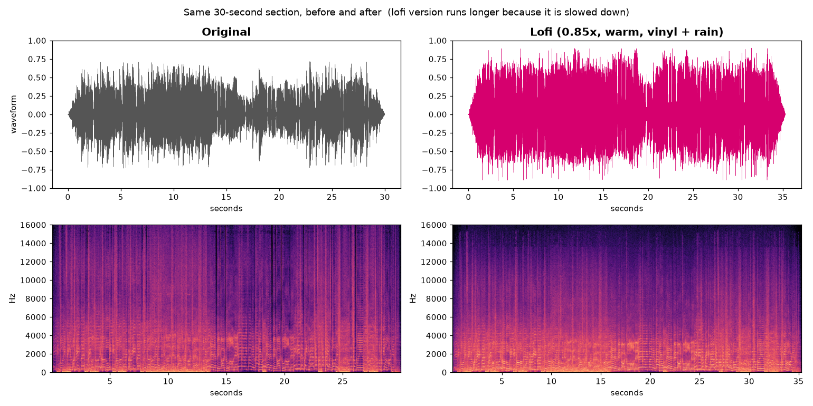

# lofi-audio — Slowed + Reverb / Lofi plugin for Claude Code

Turn any song into a **Slowed + Reverb**, **Lofi** or **Dreamy** version just by
asking Claude Code. You can add vinyl crackle, soft rain or your own ambience loop.
Everything runs on your own computer. No uploads and no accounts.

## Hear the difference

The same 30-second section, before and after:

| | Listen |
|---|---|
| Original | [before_original.mp3](examples/before_original.mp3) |
| Lofi (`--preset lofi --rain 0.15`) | [after_lofi.mp3](examples/after_lofi.mp3) |
| Slowed + Reverb (default) | [after_slowed-reverb.mp3](examples/after_slowed-reverb.mp3) |



The lofi version is longer because it is slowed down, and its high frequencies are softer
(the darker top of the right-hand spectrogram), which gives the warm, muffled lofi sound.

Demo song: "Monkeys At Typewriters", released under
[CC0](https://commons.wikimedia.org/wiki/File:Monkeys_At_Typewriters.mp3) (free for anyone to use).

```
lofi-audio/
├── .claude-plugin/plugin.json        # plugin manifest
├── .claude-plugin/marketplace.json   # lets people install straight from GitHub
├── skills/lofi-audio/
│   ├── SKILL.md                      # tells Claude when and how to use the tool
│   ├── requirements.txt
│   ├── requirements-mcp.txt          # extra library for the optional MCP server
│   └── scripts/
│       ├── lofi_fx.py                # the audio processor (CLI + importable)
│       └── mcp_server.py             # optional MCP server wrapper
├── examples/                         # before/after demo clips and picture
├── tests/test_lofi_fx.py
└── CHANGELOG.md
```

## 1. Install the plugin

In Claude Code:

```
/plugin marketplace add nasimnayan/lofi-audio
/plugin install lofi-audio@lofi-audio
```

Then just ask: *"Make a slowed + reverb version of ~/Music/song.mp3 with some rain in the background."*

The first time, Claude checks the Python libraries it needs. It asks you before installing anything.

## 2. Python libraries (if you prefer to install them yourself)

Python 3.10+ is required. Use the virtual environment below; Claude looks for it
at this exact path.

macOS / Linux:
```bash
python3 -m venv ~/.venvs/lofi-audio
~/.venvs/lofi-audio/bin/python -m pip install -r skills/lofi-audio/requirements.txt
```

Windows (PowerShell):
```powershell
py -m venv $HOME\.venvs\lofi-audio
& $HOME\.venvs\lofi-audio\Scripts\python.exe -m pip install -r skills\lofi-audio\requirements.txt
```

Check: `python skills/lofi-audio/scripts/lofi_fx.py --check`

You don't need FFmpeg for .mp3/.wav/.flac/.ogg. Install it only for .m4a/.aac input.

## 3. Use it without Claude

```bash
python skills/lofi-audio/scripts/lofi_fx.py my_song.mp3 my_song_slowed.mp3
python skills/lofi-audio/scripts/lofi_fx.py my_song.mp3 my_song_lofi.mp3 --preset lofi --rain 0.15
```

## 4. Presets

| Preset | Speed | Character |
|---|---|---|
| `slowed-reverb` | 0.80 | classic TikTok/YouTube slowed + reverb |
| `lofi` | 0.85 | muffled highs, tape wobble, light grit, vinyl crackle |
| `dreamy` | 0.78 | very large, long reverb |

`--mode vinyl` (default) drops the pitch along with the tempo. `--mode stretch` keeps the pitch.

Any sample rate (8–192 kHz) and mono to 5.1 input is supported. Existing files are
never replaced unless you pass `--overwrite`.

## 5. Optional: MCP server

```bash
~/.venvs/lofi-audio/bin/python -m pip install -r skills/lofi-audio/requirements-mcp.txt
claude mcp add lofi-audio -- ~/.venvs/lofi-audio/bin/python /ABSOLUTE/PATH/skills/lofi-audio/scripts/mcp_server.py
```

Tools: `make_lofi`, `list_presets`.

## 6. Limits

- Memory: about 200 MB per minute of input. Files over 12 minutes are refused by
  default. Use `--max-minutes 30` if your computer has enough memory.
- Claude cannot hear the result. It reports what was applied, not how it sounds.

## 7. Development

```bash
pip install -r skills/lofi-audio/requirements.txt pytest
pytest -q
```

The tests use generated test tones only, with no music files.

## 8. Licence and copyright

- This plugin's own code is released under the **MIT** licence (see `LICENSE`).
- It depends on [pedalboard](https://github.com/spotify/pedalboard) (by Spotify), which is **GPLv3**
  and is installed separately, not bundled. Check pedalboard's licence before shipping it inside a
  closed-source product.
- Vinyl crackle and rain are generated in code. If you use your own ambience file,
  choose a royalty-free (e.g. CC0) one.
- **A slowed version of a commercial song is still that artist's work.** Get permission
  from the rights holder before publishing it.
